# 财富自由之路 (Financial Freedom Tracker) — 项目施工文档

> 版本：v1.0 · 日期：2026-11-18
> 状态：已确认，施工中（2026-11-18 用户指示按本文档开始施工）

---

## 1. 项目概述

一个个人财务追踪 Web 应用，用于记录收入与支出、管理每月预算、追踪存款目标、总览资产分布与净资产趋势、维护心愿购物清单、管理投资持仓与盈亏。前端可视化，后端数据库存储全部个人数据。

**使用方式**：单人使用，无登录系统，Docker 部署（建议仅本地或内网访问；如需公网暴露，后期可加简单访问密码）。

**核心体验目标**：打开 Dashboard 一屏看清「我现在有多少钱、这个月花了多少、离目标还有多远、投资赚了还是亏了」。

---

## 2. 需求规格（已确认）

| # | 功能 | 要点 |
|---|------|------|
| 1 | 记录收入 | 手动录入（金额/币种/日期/来源分类/备注）；周期性收入自动生成；月度汇总与趋势 |
| 2 | 记录支出 | 手动录入（金额/币种/日期/分类/备注）；周期性支出自动生成；每月分类预算 + 超标提醒；分类饼图 |
| 3 | 存款目标 | 多目标并行（名称/目标金额/截止日期）；手动记「存入」；进度条 |
| 4 | 资产分布 | 按类别录入资产账户；饼图 + 总净资产；每次修改自动存快照 → 净资产历史曲线 |
| 5 | Dream 购物清单 | 物品/价格/优先级/链接/备注；标记已购 → 自动生成对应支出记录 |
| 6 | 投资 Tracker | 持仓（标的/数量/成本价/现价手动更新）→ 市值/盈亏/收益率；买卖交易自动更新持仓；组合分布与盈亏图；预留行情 API |

**全局决策**：

- 技术栈：React (Vite) + FastAPI + SQLite
- 部署：Docker Compose，无登录
- 货币：多币种录入，自动拉取汇率（每日缓存），汇总统一折算 CNY
- 投资现价：手动更新，架构预留后续接行情 API

---

## 3. 系统架构

```
┌────────────────────────────────────────────────┐
│  浏览器                                        │
│  React SPA (Vite 构建 → 静态文件)              │
└───────────────┬────────────────────────────────┘
                │ /api/* (JSON)
┌───────────────▼────────────────────────────────┐
│  Nginx 容器                                    │
│  · 托管前端静态文件                              │
│  · /api 反向代理 → backend:8000                 │
└───────────────┬────────────────────────────────┘
                │
┌───────────────▼────────────────────────────────┐
│  FastAPI 容器 (uvicorn)                        │
│  · REST API（7 个路由域）                       │
│  · 汇率服务（httpx → frankfurter.app，24h 缓存）│
│  · 周期规则惰性生成器                            │
│  · 净资产快照引擎                                │
└───────────────┬────────────────────────────────┘
                │ SQLAlchemy 2.0
┌───────────────▼────────────────────────────────┐
│  SQLite 文件 (Docker volume 持久化, WAL 模式)   │
└────────────────────────────────────────────────┘

开发模式：vite dev server (5173, 代理 /api → 8000) + uvicorn (8000, --reload)
生产模式：docker compose up → http://localhost:8080
```

**关键架构选择与理由**：

| 选择 | 理由 |
|------|------|
| SQLite 而非 PostgreSQL | 单用户单写入者，零运维；WAL 模式足够；备份即复制一个文件 |
| 无定时任务框架（APScheduler 等） | 周期收支与汇率刷新采用「惰性触发」：请求到达时检查并补生成，容器重启不丢逻辑，实现更简单可靠 |
| 汇率源 frankfurter.app | 免费无 API key、欧洲央行参考汇率、覆盖主要币种；失败时回退旧缓存 |
| 投资组合并入净资产计算 | 资产账户中**不设**股票/基金/加密货币类别（避免与投资 Tracker 双重计算），投资组合市值自动作为独立一块并入总净资产与饼图 |

---

## 4. 数据模型设计

数据库：SQLite，主键均自增 `id`。金额一律存原始币种原值（REAL），折算只发生在读取/聚合层。

### 4.1 ER 总览

```mermaid
erDiagram
    recurring_rules ||--o{ transactions : "生成"
    dream_items ||--o{ transactions : "购买联动"
    savings_goals ||--o{ savings_contributions : "存入"
    investment_holdings ||--o{ investment_trades : "买卖"

    transactions {
        int id PK
        string type "income|expense"
        real amount
        string currency
        date tx_date
        string category
        string note
        string source "manual|recurring|dream"
        int recurring_rule_id FK "可空"
        int dream_item_id FK "可空"
        datetime created_at
    }
    recurring_rules {
        int id PK
        string type
        real amount
        string currency
        string category
        string note
        int day_of_month "1-31"
        bool active
        date last_generated "可空"
    }
    budgets {
        int id PK
        string category
        string month "YYYY-MM"
        real amount_cny
    }
    savings_goals {
        int id PK
        string name
        real target_amount
        string currency
        date deadline "可空"
        string status "active|done|abandoned"
    }
    savings_contributions {
        int id PK
        int goal_id FK
        real amount
        string currency
        date contributed_at
        string note
    }
    asset_accounts {
        int id PK
        string name
        string category "cash|checking|term_deposit|real_estate|other"
        string currency
        real balance
        datetime updated_at
    }
    net_worth_snapshots {
        int id PK
        date snap_date "UNIQUE，同日覆盖"
        real total_cny
        text breakdown_json
    }
    dream_items {
        int id PK
        string name
        real price
        string currency
        string priority "high|medium|low"
        string url
        string note
        string status "pending|purchased"
        date purchased_at "可空"
    }
    investment_holdings {
        int id PK
        string symbol
        string name
        string asset_type "stock|etf|fund|crypto|bond|other"
        string currency
        real quantity
        real avg_cost
        real current_price
        datetime updated_at
    }
    investment_trades {
        int id PK
        int holding_id FK
        string action "buy|sell"
        real quantity
        real price
        real fee
        date trade_date
        real realized_pnl "卖出时写入"
        string note
    }
    exchange_rates {
        int id PK
        string currency "UNIQUE，1单位该币=CNY多少"
        real rate
        datetime fetched_at
    }
```



### 4.2 分类枚举（硬编码于前后端共享常量）

- **收入来源**：工资 salary / 奖金 bonus / 副业 side_hustle / 投资收益 investment / 其他 other
- **支出分类**：餐饮 food / 住房 housing / 交通 transport / 购物 shopping / 娱乐 entertainment / 医疗 medical / 教育 education / 其他 other
- **资产类别**：现金 cash / 活期 checking / 定期 term_deposit / 房产 real_estate / 其他 other（投资类资产一律走投资 Tracker）
- **资产类型（投资）**：股票 stock / ETF etf / 基金 fund / 加密货币 crypto / 债券 bond / 其他 other
- **币种**：CNY, USD, EUR, HKD, JPY, GBP, SGD, AUD, CAD, CHF, KRW（前端下拉选择，后端校验）

### 4.3 关键设计决策

1. **金额不做折算存储**：所有表只存原币种金额，CNY 折算值永远在 API 聚合层实时计算。汇率变了，历史报表会跟着最新汇率走 —— 对个人记账场景这是期望行为（净资产始终反映当前汇率）。
2. **预算以 CNY 计**：`budgets.amount_cny` 统一用人民币设额度，避免多币种预算的复杂度；支出按当月最新汇率折算后对比。
3. **快照同日覆盖**：`net_worth_snapshots.snap_date` UNIQUE，当天多次修改资产只保留最后一个状态，趋势图一天一个点。
4. **周期规则幂等生成**：以 `last_generated` 为游标只向前补生成；规则编辑不影响已生成的历史记录。

---

## 5. API 设计

REST，前缀 `/api`。错误统一 `{detail: string}`（FastAPI 默认）。金额折算字段统一命名 `*_cny`。

### 5.1 基础

| 方法 | 路径 | 说明 |
|------|------|------|
| GET | /health | 存活检查 |
| GET | /currencies | 币种列表 + 最新汇率 + `fetched_at` |
| POST | /rates/refresh | 强制刷新汇率 |

### 5.2 收支 transactions

| 方法 | 路径 | 说明 |
|------|------|------|
| GET | /transactions?type=&month=&category=&source=&limit= | 列表（按日期倒序）；**每次调用先触发周期补生成** |
| POST | /transactions | 新增（source 固定 manual） |
| PUT | /transactions/{id} | 修改 |
| DELETE | /transactions/{id} | 删除 |
| GET | /transactions/summary?month=YYYY-MM | `{income_cny, expense_cny, net_cny, by_category: [{category, amount_cny}], by_day: [...]}` 供饼图/趋势 |

### 5.3 周期规则 recurring

| 方法 | 路径 | 说明 |
|------|------|------|
| GET | /recurring | 规则列表（含每条已累计生成笔数） |
| POST | /recurring | 新建规则，`last_generated` 初始为空（从当月或下月开始生成） |
| PUT | /recurring/{id} | 修改（active 开关 / 金额 / 日期） |
| DELETE | /recurring/{id} | 删除规则（已生成的历史记录保留） |

### 5.4 预算 budgets

| 方法 | 路径 | 说明 |
|------|------|------|
| GET | /budgets?month=YYYY-MM | 返回全部支出分类：`[{category, budget_cny|null, spent_cny, over_budget: bool}]`（无预算的分类也返回 spent） |
| PUT | /budgets | `{category, month, amount_cny}` upsert；`amount_cny=null` 删除该预算 |
| GET | /budgets/months | 有预算的月份列表（前端月份切换器） |

### 5.5 存款目标 goals

| 方法 | 路径 | 说明 |
|------|------|------|
| GET | /goals | 列表，含 `contributed_cny`（折算累计）、`progress`（0~1）、`remaining_cny` |
| POST | /goals | 新建 |
| PUT | /goals/{id} | 修改（含 status 置 done/abandoned） |
| DELETE | /goals/{id} | 删除（级联删除存入记录） |
| GET | /goals/{id}/contributions | 存入历史 |
| POST | /goals/{id}/contributions | 记一笔存入 |
| DELETE | /contributions/{id} | 删除某笔存入 |

### 5.6 资产 assets

| 方法 | 路径 | 说明 |
|------|------|------|
| GET | /assets | 账户列表 + 汇总 `{total_cny, by_category:[{category, amount_cny}], investment_portfolio_cny}` |
| POST | /assets | 新建账户（触发快照） |
| PUT | /assets/{id} | 修改余额（触发快照） |
| DELETE | /assets/{id} | 删除（触发快照） |
| GET | /networth/history?limit=90 | 净资产趋势点列表 `[{date, total_cny}]` |

### 5.7 Dream 清单 dreams

| 方法 | 路径 | 说明 |
|------|------|------|
| GET | /dreams?status= | pending / purchased 分组返回 |
| POST | /dreams | 新建 |
| PUT | /dreams/{id} | 修改 |
| DELETE | /dreams/{id} | 删除 |
| POST | /dreams/{id}/purchase | `{amount?, currency?}`（默认取物品价格）；生成一条 `type=expense, category=shopping, source=dream` 的交易并置为 purchased |

### 5.8 投资 investments

| 方法 | 路径 | 说明 |
|------|------|------|
| GET | /investments/holdings | 持仓列表（服务端算好 `market_value, cost, pnl, pnl_rate, *_cny`），按市值排序 |
| POST | /investments/holdings | 新建持仓（初始数量 0 或直接带一笔建仓参数） |
| PUT | /investments/{id} | 更新现价 / 改名（**唯一的手动改现价入口**，触发快照） |
| DELETE | /investments/{id} | 删除持仓（需无持仓数量或强制） |
| GET | /investments/trades?holding_id= | 交易记录（倒序） |
| POST | /investments/trades | 买卖成交 → 原子更新持仓（见 §7.3），触发快照 |
| GET | /investments/summary | `{market_value_cny, total_cost_cny, unrealized_pnl_cny, realized_pnl_all_cny}` |

### 5.9 Dashboard

| 方法 | 路径 | 说明 |
|------|------|------|
| GET | /dashboard | 一次返回首页全部数据（见 §7.7），触发周期补生成 + 惰性汇率刷新 |

---

## 6. 前端信息架构

### 6.1 路由与页面

| 路由 | 页面 | 内容 |
|------|------|------|
| `/` | Dashboard | 净资产总额卡 + 趋势迷你图；本月收入/支出/结余三卡；存款目标进度条组；预算使用状态条；投资组合盈亏卡；最近交易 |
| `/transactions` | 收支记录 | 月份切换、类型/分类筛选、摘要卡（月收入/支出/结余）、分类饼图、每日柱状趋势、交易表（新增/编辑弹窗、删除）、周期规则 Tab |
| `/budget` | 预算管理 | 月份切换、每支出分类：预算额输入 + 已用进度条（超支红色）、本月总预算 vs 总支出 |
| `/goals` | 存款目标 | 目标卡片（进度环/条、剩余金额、截止倒计时）、存入弹窗、存入历史抽屉、新建目标 |
| `/assets` | 资产分布 | 总净资产 + 组成饼图（账户类别 + 投资组合）、账户卡片 CRUD、净资产历史折线图 |
| `/dreams` | Dream 清单 | 待购清单（按优先级排序）、已购归档区、购买弹窗（可改实付金额）、购买力提示 |
| `/investments` | 投资 Tracker | 组合摘要卡（市值/成本/浮动盈亏/累计已实现盈亏）、持仓表（行内改现价）、记录买卖弹窗、组合分布饼图、持仓盈亏横向条形图、交易历史表 |

### 6.2 技术选型

- **React 18 + Vite**：开发体验与构建速度
- **react-router-dom v6**：路由
- **Recharts**：图表（饼图/折线/柱状/进度条自绘 CSS），React 原生集成好
- **day.js**：日期处理（月份切换、倒计时）
- **axios**：请求层（统一 `/api` 前缀 + 错误 toast）
- **纯 CSS 设计系统**：CSS variables 定义色板/间距/圆角，组件级 className，不引入 UI 框架，保持轻量可控
- 中文界面，金额格式化 `Intl.NumberFormat('zh-CN')`，多币种显示 `¥1,234.56 / $100.00` 原币 + 折算值双显

### 6.3 视觉方向

金融仪表盘风格：浅色主题、清爽留白；语义色（收入=绿、支出=红/橙、盈利=绿、亏损=红、超支=红）；左侧固定导航栏 + 内容区；卡片式布局；图表配色遵循 dataviz 规范（构建时应用）。

---

## 7. 核心实现路径分析（难点逐个拆解）

### 7.1 多币种与汇率引擎

**数据流**：

```
请求需要折算 → ensure_rates_fresh()
  → 查 exchange_rates.fetched_at，若 < 24h 直接用缓存
  → 否则 httpx GET https://api.frankfurter.app/latest?base=CNY&symbols=USD,EUR,...
  → 成功：upsert 全部 rate + fetched_at
  → 失败（网络/超时 5s）：沿用旧缓存，响应带 rates_stale=true，前端在页脚提示「汇率更新于 X」
```

- 汇率存「1 单位外币 = X CNY」方向（frankfurter 返回 base=CNY 的倒数，写入时取倒数换算）
- 折算函数 `to_cny(amount, currency)`：CNY 直接返回；无缓存汇率时抛 409 让前端提示先刷新
- CNY 自身不存表，恒为 1

### 7.2 周期收支惰性生成器

```
ensure_recurring_due(today):          # 在 GET /transactions、GET /dashboard 时调用
  for rule in active_rules:
    cursor = rule.last_generated 或 规则创建当月的下一期
    while 下一期日期 <= today:
      date = clamp(day_of_month, 当月天数)   # 31 号规则在 2 月落在 2/28
      若不存在 (recurring_rule_id=rule.id, tx_date=date) 的交易:  # 幂等保险
        插入交易(source='recurring')
      cursor = 下一期
    rule.last_generated = 最后生成日期
```

- 首次建规则：`last_generated = null`，从**当月**开始生成（当天及之前的当月期数一次性补齐）
- 规则停用（active=false）：停止生成，已有记录不动
- 全程在一个 DB 事务内，避免并发请求重复生成（SQLite 写锁天然串行化）

### 7.3 投资持仓算法（本项目计算核心）

设当前持仓 `Q`（数量）、`C`（加权平均成本价）：

**买入**（数量 q、价格 p、费用 f）：
```
新成本总额 = Q×C + q×p + f
新数量     = Q + q
C = 新成本总额 / 新数量        （费用摊入成本）
Q = 新数量
```

**卖出**（数量 q、价格 p、费用 f）——校验 `q ≤ Q`：
```
已实现盈亏 = (p − C)×q − f      → 写入该笔 trade.realized_pnl
Q = Q − q                       （C 不变）
若 Q == 0: C 重置为 0            （下次买入从零起算，避免旧成本污染）
```

**估值**（现价 m 手动维护）：
```
市值       = Q × m
成本       = Q × C
浮动盈亏   = Q × (m − C)
收益率     = (m − C) / C
```

现价更新走 `PUT /investments/{id}`，`updated_at` 记录价格时效，前端显示「价格更新于 X」。

### 7.4 净资产快照引擎

```
take_snapshot():                    # 资产账户或投资持仓/现价任何变更后调用
  total_cny = Σ(账户余额×汇率) + Σ(持仓市值×汇率)
  breakdown = {cash:…, checking:…, term_deposit:…, real_estate:…, other:…,
               investment_portfolio:…}   # 各项均已折算 CNY
  upsert net_worth_snapshots by snap_date=today   # 同日覆盖
```

- 趋势图 = `SELECT * FROM net_worth_snapshots ORDER BY snap_date DESC LIMIT 90` 反转
- 没有任何资产和持仓时不生成快照（避免零点污染曲线）

### 7.5 Dream 购买联动

```
purchase(dream_id, amount?, currency?):
  事务内:
    1. 创建交易 {type: expense, category: shopping, source: dream,
                amount: amount ?? dream.price, currency: currency ?? dream.currency,
                tx_date: today, note: 'Dream 购入: {dream.name}'}
    2. dream.status = purchased, purchased_at = today
```

- 购买后想反悔：去收支页删除那条交易 + 手动把物品改回 pending（保持简单，不做反向自动化）
- 「购买力提示」：前端用 Dashboard 的本月结余对比物品折算价，显示「≈ 本月结余的 X%」

### 7.6 预算计算

```
GET /budgets?month:
  for category in 支出分类枚举:
    spent_cny = Σ(该月该分类 expense 交易)×汇率      # 含周期生成与 Dream 联动的交易
    budget_cny = budgets 表查询（可能 null）
    over_budget = budget != null && spent > budget
```

- 预算进度条：`min(spent/budget, 1)`，超额部分红条 + 「超 ¥xxx」标注

### 7.7 Dashboard 聚合（单请求返回）

```json
{
  "net_worth": {"total_cny": 123456.78, "trend": [{"date":"2026-11-01","total_cny":…}, …]},
  "month": {"income_cny": …, "expense_cny": …, "net_cny": …},
  "goals": [{"id":1,"name":"应急基金","target_cny":…,"contributed_cny":…,"progress":0.6,"deadline":…}],
  "budgets": [{"category":"food","budget_cny":3000,"spent_cny":2450,"over_budget":false}],
  "investments": {"market_value_cny":…,"cost_cny":…,"unrealized_pnl_cny":…,"realized_pnl_cny":…},
  "recent_transactions": [ … 最近 10 笔 … ],
  "rates_stale": false
}
```

一次请求、后端并行计算各块、惰性触发 §7.1/§7.2。

---

## 8. 项目目录结构

```
Financial_Freedom_Tracker/
├── README.md                     # 快速开始（docker compose up / 开发模式）
├── docs/CONSTRUCTION.md          # 本文档
├── .gitignore
├── docker-compose.yml
│
├── backend/
│   ├── Dockerfile
│   ├── requirements.txt          # fastapi uvicorn sqlalchemy pydantic httpx
│   └── app/
│       ├── main.py               # FastAPI 装配、CORS、路由注册、建表
│       ├── database.py           # engine/session（WAL、外键开启）
│       ├── models.py             # §4 全部表
│       ├── schemas.py            # Pydantic v2 请求/响应模型
│       ├── constants.py          # 分类/币种枚举（与前端对齐）
│       ├── services/
│       │   ├── rates.py          # §7.1 汇率引擎
│       │   ├── recurring.py      # §7.2 周期生成器
│       │   ├── snapshots.py      # §7.4 快照引擎
│       │   └── money.py          # to_cny / 聚合工具
│       └── routers/
│           ├── transactions.py   # + summary
│           ├── recurring.py
│           ├── budgets.py
│           ├── goals.py
│           ├── assets.py         # + networth history
│           ├── dreams.py
│           ├── investments.py
│           └── dashboard.py
│
├── frontend/
│   ├── Dockerfile                # 多阶段：node build → nginx
│   ├── nginx.conf                # 静态托管 + /api 代理
│   ├── package.json
│   ├── vite.config.js            # dev 代理 /api → 8000
│   ├── index.html
│   └── src/
│       ├── main.jsx / App.jsx    # 路由 + 布局
│       ├── api/client.js         # axios 实例 + 错误处理
│       ├── constants.js          # 枚举与展示名映射（与后端对齐）
│       ├── components/           # Card, Modal, MoneyInput, ProgressBar, EmptyState…
│       └── pages/
│           ├── Dashboard.jsx
│           ├── Transactions.jsx
│           ├── Budget.jsx
│           ├── Goals.jsx
│           ├── Assets.jsx
│           ├── Dreams.jsx
│           └── Investments.jsx
└── (SQLite 数据文件只在运行时存在于 volume，不入库)
```

---

## 9. 实施里程碑

| 里程碑 | 内容 | 完成标志 |
|--------|------|----------|
| M0 | 本施工文档 | 用户确认 |
| M1 | 后端：模型 + 全部 API + 汇率/周期/快照三个引擎 + pytest 冒烟（关键算法单测：买卖均价、周期幂等、快照折算） | curl 走通全部端点 |
| M2 | 前端：工程搭建 + 六大页面 + Dashboard 全部组件接通 API | 浏览器可用 |
| M3 | 联动与体验打磨：折算双显、超支红条、空状态、加载/错误态、图表规范配色 | 端到端场景验收（§11） |
| M4 | Docker 化：双 Dockerfile + compose + volume 持久化验证 | `docker compose up` 一键起 |
| M5 | README、提交、推送远端 | GitHub 可见 |

每里程碑完成后本地提交一次，粒度可回溯。

---

## 10. Docker 部署方案

```yaml
# docker-compose.yml（示意）
services:
  backend:
    build: ./backend
    volumes: [fft_data:/data]
    environment: [DB_PATH=/data/fft.db]
    restart: unless-stopped
  frontend:
    build: ./frontend        # nginx: 静态 + proxy /api → backend:8000
    ports: ["8080:80"]
    depends_on: [backend]
    restart: unless-stopped
volumes:
  fft_data:                  # SQLite 数据持久化；备份 = 备份该 volume
```

- backend 镜像：`python:3.12-slim` + uvicorn（单 worker，SQLite 场景足够）
- frontend 镜像：`node:20-alpine` 构建 → `nginx:alpine` 运行（多阶段，产物 < 50MB）
- 访问：`http://<host>:8080`

---

## 11. 验收标准（端到端场景清单）

- [ ] 录入一笔 USD 收入，Dashboard/月度汇总按当日汇率折算 CNY 正确显示双币
- [ ] 建立月度房租周期规则，跨月后访问页面自动补生成，重复刷新不产生重复记录
- [ ] 给「餐饮」设 3000 预算，录支出使其超限，预算条变红并显示超额数
- [ ] 新建存款目标并记两笔存入，进度条与剩余金额计算正确（多币种存入正确折算）
- [ ] 修改任一资产账户余额，净资产趋势图当日点更新且不产生重复点
- [ ] Dream 物品点「已购买」，收支列表出现一条 `source=dream` 的购物支出
- [ ] 投资：买入→均价含费用；卖出→数量减少、已实现盈亏正确、清仓后均价归零；改现价→市值/浮盈/组合饼图/净资产全部联动
- [ ] 断网启动时汇率用旧缓存，界面显示「汇率更新于 X」不崩溃
- [ ] `docker compose up -d` 后所有上述场景在 http://localhost:8080 可复现，重启容器数据不丢

---

## 12. 风险与预留扩展

| 项 | 风险/限制 | 预案 |
|----|-----------|------|
| 汇率源 | frankfurter 不可用或缺少某币种 | 旧缓存回退 + 前端 stale 提示；换源只需改 `services/rates.py` 一处 |
| 行情 API（后期） | 人工更新现价遗忘导致盈亏失真 | `PUT /investments/{id}` 是唯一改价入口，扩展点：新增 `services/price_provider.py` 定时任务按 symbol 拉价写同一字段，前端零改动 |
| 公网部署 | 无登录，数据裸奔 | 预留：nginx basic_auth 一行配置即可启用，应用层零改动 |
| SQLite 并发 | 单用户场景基本无风险 | WAL + 单 uvicorn worker；如将来多用户再迁移 PostgreSQL（SQLAlchemy 屏蔽方言） |
| 数据备份 | volume 内单文件 | 预留 `GET /api/export`（全库 JSON 导出）作为 M5 后可选增强 |

---

## 13. 待用户确认点

以上即为完整施工方案。若无异议，按 M1 → M5 顺序开工。可在确认时提出的调整项：

1. 资产账户**不含**投资类别（投资统一走 Tracker 并入净资产）—— 是否接受？
2. 预算统一以 CNY 设额 —— 是否接受？
3. Dream 购买反悔需手动删交易 —— 是否接受？
4. 币种清单（CNY/USD/EUR/HKD/JPY/GBP/SGD/AUD/CAD/CHF/KRW）是否够用？
